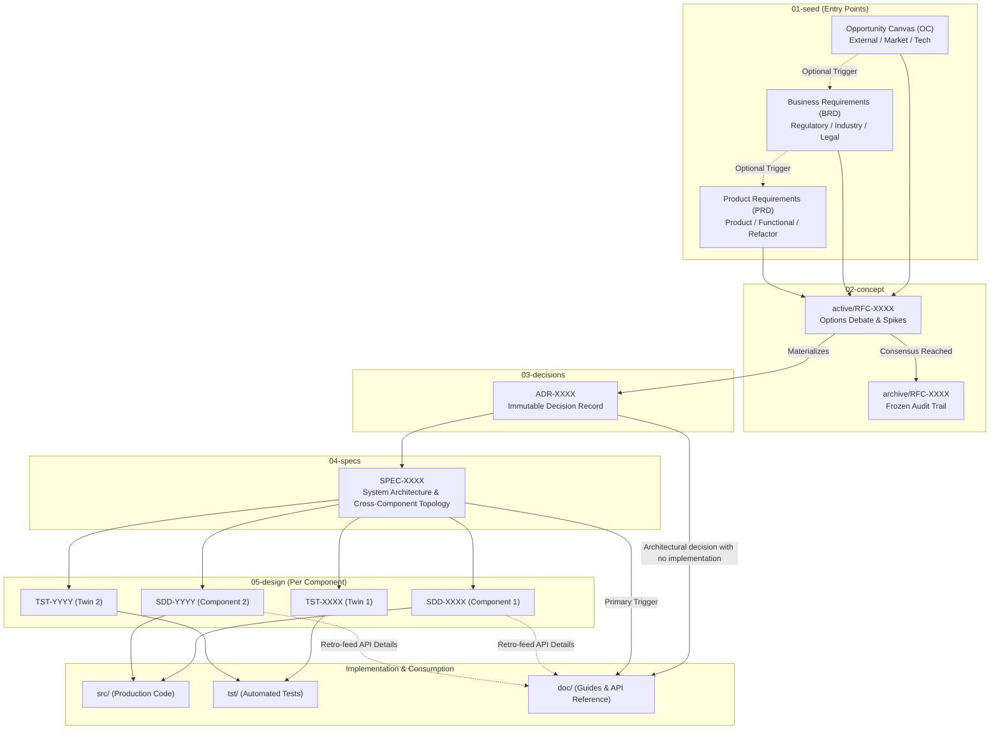

# RFC-0001: Baseline Engineering-as-Code (EoC) Workflow Lifecycle

## 1. Problem Statement
* **Technical Challenge:**
  In automated and AI-assisted development environments, engineering initiatives frequently suffer from architectural drift, undocumented design decisions, and decoupled code/test implementations. Without an explicit, strictly governed progression pipeline, human contributors and autonomous agents will invent ad-hoc development flows, bypassing architecture reviews and invalidating the repository's machine-navigable dependency graph.
* **Context:**
  Derived from [PID-0001-OC-Workflow.md](arch/01-seed/PID-0001-OC-Workflow.md), this RFC formalizes the foundational development lifecycle for the Engineering-as-Code (EoC) framework. It establishes the mandatory macro-pipeline, defines the scope and entry criteria for each artifact tier, and dictates the immutability boundaries across phases.

---

## 2. Proposed Architecture & Workflow Mechanics

### Core Workflow Diagram

### Invariant Rules of the Macro-Pipeline

1. **Strict Macro Progression ("No Skipping, Early Exit Allowed"):**
   * The baseline sequence is strictly:
     $$\mathbf{01\text{-}seed} \longrightarrow \mathbf{02\text{-}concept} \longrightarrow \mathbf{03\text{-}decisions} \longrightarrow \mathbf{04\text{-}specs} \longrightarrow \mathbf{05\text{-}design} \longrightarrow \mathbf{Execution}$$
   * **No step can ever be skipped.** Code or design changes cannot bypass an RFC, an ADR, or a system SPEC.
   * **Early Exit Property:** A workflow may terminate at any phase without advancing (e.g., an OC deemed unviable, an RFC concluded with a decision to reject, or a governance ADR that introduces an organizational policy without requiring new software specs).

2. **Phase Definitions & Artifact Responsibilities:**

   * **`arch/01-seed/` (Strategic & Requirements Entry Points):**
     Every initiative must originate with a Seed artifact. Contributors choose the entry point according to the governing trigger:
     * **Opportunity Canvas (`PID-XXXX-OC`):** Triggered by external market shifts, emerging technologies, or exploratory capabilities. Answers: *Should we pursue this, and what is the potential value?*
     * **Business Requirements Document (`PID-XXXX-BR`):** Triggered by industry regulations, legal compliance, tax laws, or commercial contracts. Answers: *What business and legal guardrails must be respected?*
     * **Product Requirements Document (`PID-XXXX-PR`):** Triggered directly by product needs, user journeys, deprecation cycles, or feature requests. Answers: *What functional capabilities and user behaviors must be delivered?*
     * *Chaining:* While an OC may trigger a BRD, and a BRD may trigger a PRD, chained progression is **not mandatory**. An initiative may enter directly at any seed type and progress straight to an RFC.

   * **`arch/02-concept/` (Debate & Exploration):**
     * All architectural changes, proposals, and spikes must be explored in a Request for Comments (`RFC-XXXX`).
     * While debates are ongoing, the RFC resides in `arch/02-concept/active/`.
     * An individual seed document may spawn multiple distinct RFCs if the scope addresses multiple independent architectural concerns.

   * **`arch/03-decisions/` (Crystallization & Immutability):**
     * Once community or agent consensus is reached on an RFC, the outcome is recorded as an Architecture Decision Record (`ADR-XXXX`).
     * **RFC Freezing:** Upon ADR approval, the active RFC is updated to link to the ADR, marked as `accepted` (or `rejected`), and moved to `arch/02-concept/archive/`. It becomes strictly read-only to preserve the historical debate trail.
     * **ADR Immutability:** ADRs are strictly immutable (append-only). To modify a past decision, a new RFC and superseding ADR must be authored.

   * **`arch/04-specs/` (System-Level Topology):**
     * A `SPEC-XXXX` outlines end-to-end data flows, service boundaries, cross-component interfaces, and high-level architectural requirements derived from the governing ADR.
     * `04-specs` acts as the primary trigger for user-facing documentation in `doc/` (architecture guides, operator manuals).

   * **`arch/05-design/` (Component Design & Test Twins):**
     * A single `SPEC-XXXX` may touch or introduce multiple separate components or subsystems.
     * For **each distinct component**, a Software Design Document (`SDD-XXXX`) is paired with an exact numerical Test Twin (`TST-XXXX`).
     * `SDD-XXXX` details internal data models, state machines, and algorithms, directly feeding `src/`.
     * `TST-XXXX` defines the executable verification harness, evaluation benchmarks, and BDD assertions, directly feeding `tst/`.
     * Low-level API contracts from `SDD` retro-feed `doc/api-reference`.

### 2.1 Issues, Defects, and Remediation Lifecycle

A framework is only as good as its defect management. In the EoC framework, issues, bugs, regressions, and incidents are not tracked in an ad-hoc silo outside the architecture—they are formally integrated into the macro-pipeline:

```mermaid
flowchart TD
    Issue["Post-Merge Issue / Defect Detected"] --> Triage{"Triage Nature of Issue"}
    
    Triage -->|"Functional crash / defect / incorrect behavior"| PRD["PID-XXXX-PR<br/>(Product Requirements)"]
    Triage -->|"Regulatory violation / compliance / legal gap"| BRD["PID-XXXX-BR<br/>(Business Requirements)"]
    Triage -->|"Weakness / latent fragility / sub-optimal trait"| OC["PID-XXXX-OC<br/>(Opportunity Canvas)"]
    
    PRD --> Pipeline["Macro-Pipeline<br/>RFC (Lean Evaluation) &#8594; ADR &#8594; SPEC &#8594; SDD + TST"]
    BRD --> Pipeline
    OC --> Pipeline
```

#### 1. In-Flight Work Boundary vs. Post-Merge Issues
* **In-Flight Validation Failures ($\neq$ New Issue):** If automated tests fail during active feature development or pull request CI/CD runs, this is **not** an issue. Work is not completed until code passes CI/CD and is merged. The developer or agent simply iterates on `src/` and `tst/` within the existing lifecycle task.
* **Post-Merge Issues ($\rightarrow$ New Seed):** When a defect, unexpected behavior, or compliance gap is detected in released/merged code, it formally enters the workflow as a new Seed.

#### 2. Seed Triage for Defects
Every issue maps directly into one of the three canonical seeds based on the nature of the defect:
* **Product Requirements (`PID-XXXX-PR`):** Applied when the issue is a functional crash, exception, incorrect output, or unintended behavior of an existing product capability.
* **Business Requirements (`PID-XXXX-BR`):** Applied when the issue causes a violation of regulatory compliance, tax legislation, data sovereignty/privacy laws, or contractual business commitments.
* **Opportunity Canvas (`PID-XXXX-OC`):** Applied when the issue is not an outright failure or crash, but exposes a weakness, architectural fragility, sub-optimal performance bottleneck, or structural vulnerability that warrants exploration.

#### 3. Mandatory Evaluation (Lean RFC & ADR for Fixes)
* Even localized or simple bug fixes must pass through an `RFC` and `ADR`.
* The RFC can be concise, but its purpose is deliberate: **to force an explicit risk evaluation of the proposed fix, prevent knee-jerk patches, and ensure the remediation does not introduce collateral regressions**.
* The resulting `ADR` logs why the fix was implemented in that manner, safeguarding against future regressions.

#### 4. The Test Twin Remediation Guarantee
* If a bug made it past CI/CD into merged code, **the existing test suite was deficient by definition**.
* Therefore, remediation requires that the paired Test Twin (`TST-XXXX`) and automated test in `tst/` be updated **first** with a failing reproduction case.
* Code in `src/` is only updated to satisfy the newly updated test twin.

---

## 3. Evaluated Approaches & Alternatives

### Option A: The Strict Invariant Pipeline with Test Twins (Proposed)
* **Technical Design:** As detailed above. Rigid progression across all 5 macro-tiers, RFC archival freezing, 1-to-many SPEC to SDD/TST decomposition, and dual-trigger documentation.
* **Pros:**
  * Eliminates architectural drift and prevents rogue code injection by agents or developers.
  * Guarantees 100% test specification coverage prior to writing executable code.
  * Preserves an auditable, immutable trail of *why* decisions were made.
  * High structural predictability for automated LLM context traversal.
* **Cons:**
  * Perceived overhead for simple or routine tasks (mitigated by the lean format of initial RFC templates).

### Option B: Fast-Track / Tiered Pipeline (Permitting Step Skipping)
* **Technical Design:** Allow minor changes or direct PRDs to jump straight from `01-seed` to `04-specs` or `05-design`, bypassing RFC and ADR stages for "trivial" updates.
* **Pros:**
  * Faster initial velocity for minor bug fixes or small component patches.
* **Cons:**
  * "Trivial" is subjective; causes subtle architectural drift over time.
  * Autonomous AI agents struggle to accurately classify threshold boundaries for skipping steps, breaking dependency graph integrity.
  * Loses institutional memory regarding why smaller design changes occurred.

---

## 4. Trade-Off Analysis

| Evaluation Criteria | Option A (Strict Pipeline) | Option B (Tiered / Fast-Track) |
| :--- | :--- | :--- |
| **Architectural Rigor** | **High:** Every decision is formally anchored. | **Low / Medium:** Prone to unrecorded deviations. |
| **Agent Determinism** | **High:** Predictable state transitions and graph traversal. | **Low:** Agent must guess when steps are skippable. |
| **Auditability & Traceability** | **Complete:** Full lineage from Seed to Code/Tests. | **Fragmented:** Gaps in intermediate records. |
| **Initial Authoring Friction** | Moderate (requires drafting RFC & ADR). | Low for minor changes. |

---

## 5. Open Questions & Community Discussion

The viability of the EoC framework depends on balancing architectural rigor with daily engineering reality. If the workflow proves too rigid or cumbersome for routine maintenance and incident remediation, developers and agents will find workarounds or abandon the methodology. 

We specifically open the following structural dilemmas for debate among collaborators:

### 5.1 The Defect Friction Dilemma: Pragmatism vs. Purity
1. **The "Single-Line Bug" Burden:**
   * For trivial bugs (e.g., a missing null check, an off-by-one index, an inverted boolean flag, or a minor CSS tweak), does requiring 5 separate documents across all governance tiers (`PRD -> RFC -> ADR -> SPEC -> SDD + TST`) impose unacceptable developer friction?
   * *Alternative to debate:* Should localized implementation bugs permit an **Atomic Remediation Record (ARR)**—a single consolidated document that bundles the root-cause assessment, remediation decision, targeted spec update, and test twin—while preserving the machine-navigable graph, or must each tier strictly remain an independent file?

2. **Emergency Hotfixes & Break-Glass Procedures:**
   * How should the framework respond during a severe P0 production incident or security vulnerability where minutes matter?
   * Should there be a sanctioned "break-glass" procedure (e.g., deploy a hotfix immediately alongside a mandatory new failing-then-passing test twin in `tst/`, with a strict SLA to produce retroactive architectural documentation within 24–48 hours)?
   * Or does providing a "break-glass" mechanism inevitably create a loophole that erodes framework discipline over time?
   * *Active Investigation:* A dedicated exploration of an emergency incident workflow has been seeded to evaluate a formal fast-track with post-incident governance reconciliation. See [PID-0002-OC](arch/01-seed/PID-0002-OC-incident-workflow.md).

3. **Artifact Proliferation vs. In-Place Evolution:**
   * When fixing a bug in an existing component that is already governed by `SPEC-0002` and `SDD-0004` / `TST-0004`:
     * Do we generate **brand new numbered documents** (e.g., `SPEC-0010`, `SDD-0015`, `TST-0015`) for the fix?
     * Or do we **evolve the existing documents in-place** via version-controlled git diffs, updating `SDD-0004` and adding the new regression assertion directly to `TST-0004` while linking to the bug's seed/decision?
   * How do we avoid repository clutter across hundreds of lifetime defect remediations?

4. **Human vs. Autonomous Agent Asymmetry:**
   * AI agents have infinite patience and can scaffold multiple governance artifacts in seconds, whereas human contributors face high cognitive friction when authoring ceremony documentation.
   * If automated tooling or agents handle the document generation, how do we prevent "rubber-stamping" reviews where human engineers approve generated specs without meaningful verification?

### 5.2 Governance & Tooling Questions
5. **Automated Lineage Enforcement:**
   * How should CI/CD pipelines programmatically enforce that any PR introducing code in `src/` or `tst/` has a valid upstream lineage traversing through `arch/05-design` back to an accepted `ADR` and `Seed`?
6. **Operational & Housekeeping Updates:**
   * Are there zero-code operational updates (e.g., CI workflow configuration, repo housekeeping, template updates, documentation reformatting) that should follow a lighter governance track, or must all changes without exception produce an ADR?
