# RFC-0002: Operational Incident Response Lifecycle and Incident Twins (OID)

## 1. Problem Statement
* **Technical Challenge:**
  The baseline Engineering-as-Code (EoC) workflow mandates a strict sequential progression across five macro phases:
  $$\mathbf{01\text{-}seed} \longrightarrow \mathbf{02\text{-}concept} \longrightarrow \mathbf{03\text{-}decisions} \longrightarrow \mathbf{04\text{-}specs} \longrightarrow \mathbf{05\text{-}design} \longrightarrow \mathbf{Execution}$$
  While this progression eliminates architectural drift during planned feature delivery, enforcing it during critical production outages or severe security emergencies introduces unacceptable operational latency. When systems are failing, engineers and autonomous agents cannot afford to author full RFCs, ADRs, and system SPECs before mitigating the crisis. Without an explicit, sanctioned emergency fast-track, teams inevitably resort to out-of-band "shadow engineering"—merging unanchored hotfixes directly into `src/`—which destroys the integrity of the repository's dependency graph and causes post-incident learnings to be forgotten.
* **Context:**
  Derived from [PID-0002-OC-incident-workflow.md](arch/01-seed/PID-0002-OC-incident-workflow.md), this RFC formalizes an alternative emergency workflow. It introduces structural gates that enable rapid crisis containment while guaranteeing subsequent retrospective review and the formal consolidation of architectural learnings into the project knowledge base.

---

## 2. Proposed Architecture: The Incident Twin Lifecycle

### Core Lifecycle Flowchart

```mermaid
flowchart TD
    subgraph ActiveIncident["arch/99-incidents/active/"]
        IR["OID-XXXX-IR (Incident Report)<br/>Status: in-progress &#8594; contained &#8594; finished<br/>Telemetry, triage log, containment plan"]
        PM["OID-XXXX-PM (Post-Mortem)<br/>Status: draft &#8594; under-review &#8594; approved &#8594; closed<br/>Root cause, systemic failures, follow-up audit"]
    end

    subgraph HotfixExecution["Emergency Containment Fast-Track"]
        SDD["SDD-YYYY (Hotfix Design)"]
        TST["TST-YYYY (Reproduction Twin)"]
        SRC["src/ (Hotfix Patch)"]
        TST_CODE["tst/ (Passing Harness)"]
    end

    subgraph UpstreamGovernance["Long-Term Governance Loop"]
        Seed["New Seed (OC / BRD / PRD)<br/>Systemic architectural rework"]
        MacroPipeline["Standard Macro-Pipeline<br/>(RFC &#8594; ADR &#8594; SPEC &#8594; SDD + TST)"]
    end

    subgraph Archive["arch/99-incidents/archive/"]
        ClosedTwin["OID-XXXX-IR (finished)<br/>OID-XXXX-PM (closed)"]
    end

    %% Containment execution
    IR -->|"Drives Fast-Track (1:M)"| SDD & TST
    SDD --> SRC
    TST --> TST_CODE
    
    %% Post-mortem transition
    IR -.->|"Stabilized / Contained"| PM
    PM --> RootCauseCheck{"Does root cause require<br/>systemic rework?"}
    
    %% Upstream Seed Lock
    RootCauseCheck -->|"Yes"| SpawnSeed["Draft Upstream Seed<br/>(relations.derives_from: OID-XXXX-PM)"]
    SpawnSeed --> Seed
    Seed --> MacroPipeline
    SpawnSeed --> CloseIncident["Close PM & Mark IR finished"]
    
    RootCauseCheck -->|"No (Localized defect)"| CloseIncident
    
    CloseIncident --> ClosedTwin
```



---

### Core Structural Principles

#### 1. Separation of Concerns: The Incident Twin (`OID-XXXX`)
Emergency handling is decoupled into two complementary documents located under `arch/99-incidents/`:
* **Incident Report (`OID-XXXX-IR-...md`):**
  * Focuses strictly on **immediate containment**.
  * Documents incident detection, telemetry anomalies, blast radius, reproduction steps, and the immediate containment action plan.
  * Fast-tracks execution by directly commissioning emergency Software Design Documents (`SDD-YYYY`) and Test Twins (`TST-YYYY`) without prior RFC/ADR/SPEC cycles.
  * Status progression: `in-progress` $\rightarrow$ `contained` $\rightarrow$ `finished`.
* **Post-Mortem (`OID-XXXX-PM-...md`):**
  * Focuses on **systemic analysis and root-cause learning**.
  * Initiated once the system reaches a stabilized or contained state.
  * Evaluates underlying structural defects, process breakdowns, and determines whether the root cause warrants broader architectural rework.
  * Status progression: `draft` $\rightarrow$ `under-review` $\rightarrow$ `approved` $\rightarrow$ `closed`.

#### 2. Decoupled Monotonic Numbering & Many-to-One ($M:1$) Cardinality
* There is **no coupled sequence numbering** between `OID-XXXX` and `SDD-YYYY` / `TST-YYYY`.
* Software design documents (`SDD`) and test twins (`TST`) maintain their own global monotonic sequence under `arch/05-design/`.
* A single catastrophic incident containment may require modifying or introducing multiple distinct modules ($1 \text{ OID-IR} \rightarrow M \text{ (SDD + TST)}$).
* Traceability is maintained deterministically through frontmatter metadata:
  ```yaml
  relations:
    derives_from: ["arch/99-incidents/active/OID-0001-IR-db-connection-exhaustion.md"]
  ```

#### 3. The Test Twin Hotfix Requirement
* Emergency velocity cannot excuse unverified code.
* A hotfix code change cannot be merged into `src/` without an accompanying Test Twin (`TST-YYYY`) and executable automated test in `tst/` reproducing the defect and verifying containment.

#### 4. The Upstream Seed Lock (Anti-Amnesia Guarantee)
* **The Problem:** In fast-paced engineering teams, post-mortems are routinely drafted with ambitious action items that get abandoned once the emergency subsides.
* **The Structural Gate:**
  * An Incident Report (`IR`) **cannot** transition to `finished` until its paired Post-Mortem (`PM`) is formally approved.
  * If the Post-Mortem identifies that resolving the root cause requires systemic architectural, regulatory, or functional rework, the incident twin **cannot be closed or moved from `active/` to `archive/` until the draft of the new Seed (`OC`, `BRD`, or `PRD`) has been created** and bound in frontmatter (`relations.derives_from: [OID-XXXX-PM]`).

#### 5. Framework Mechanism vs. Project Runbook Policy
* **Framework Role:** Establishes the folder layout (`arch/99-incidents/active|archive/`), frontmatter schemas, state transitions, and the immutable archival closure gate.
* **Project Runbook Role:** Business criteria and operational policies are inherently domain-specific and must be defined in the project's operational runbook (`doc/operators-manual/runbook.md`), including:
  * Qualification criteria: Defining what severity threshold (e.g., P0/P1, data loss, security CVE) authorizes the opening of an `OID-IR`.
  * Authorization roles: Who possesses authority to trigger an emergency bypass.
  * Resolution SLAs: Target turnaround timeframes for containment and post-mortem approval (e.g., PM approved within 48 to 72 hours of containment).

---

## 3. Evaluated Approaches & Alternatives

### Option A: Decoupled Incident Twins with Structural Closure Gate (Proposed)
* **Technical Design:** As detailed above. Dual-document model (`OID-IR` + `OID-PM`), $M:1$ design cardinality, separate active/archive states, and programmatic blocking of archival until follow-up seeds are physically initialized.
* **Pros:**
  * Clearly separates the frantic operational triage phase from calm, reflective root-cause analysis.
  * Solves "post-mortem amnesia" by enforcing a structural gate between incident closure and upstream seed creation.
  * Maintains absolute graph traceability without forcing cumbersome RFC/ADR authoring during active outages.
* **Cons:**
  * Requires managing two files per incident rather than a single monolithic log.

### Option B: Unified Single Incident Document (All-in-One Record)
* **Technical Design:** A single document (`OID-XXXX.md`) where the top half contains incident telemetry and the bottom half captures post-mortem analysis once resolved.
* **Pros:**
  * One single artifact per incident.
* **Cons:**
  * Conflates active containment operations with post-incident analysis.
  * Creates ambiguous document status lifecycles (e.g., how to represent an incident whose triage is contained but whose post-mortem remains disputed).
  * Increases document churn and conflict during multi-party incident retrospectives.

### Option C: Ad-Hoc Break-Glass Git Branch Flow
* **Technical Design:** No dedicated incident artifacts. Merging hotfixes directly to `main` via emergency branches (`hotfix/*`) with a commit header tag, followed by an obligation to retroactively author standard `PRD -> RFC -> ADR` artifacts.
* **Pros:**
  * Zero authoring friction during the crisis.
* **Cons:**
  * Highly susceptible to abandonment. Once the fire is out, teams consistently fail to produce retroactive documentation, leading to undocumented codebase drift.
  * Provides zero real-time visibility or structured triage logs in the repository.

---

## 4. Trade-Off Analysis

| Evaluation Criteria | Option A (Incident Twins) | Option B (Unified Document) | Option C (Ad-Hoc Break-Glass) |
| :--- | :--- | :--- | :--- |
| **Response Latency** | **Minimal:** Direct line from IR to SDD/TST. | **Minimal:** Fast edit of single file. | **Zero:** Immediate code commit. |
| **Auditability & Traceability** | **Complete:** Clean state and distinct roles. | **Moderate:** Conflated operational states. | **Poor:** High risk of missing records. |
| **Post-Mortem Accountability** | **Enforced:** Archival blocked by Seed Lock. | **Partial:** Relies on manual checklist. | **None:** Frequently abandoned. |
| **Operational State Clarity** | **High:** Explicit IR and PM lifecycles. | **Low:** Mixed document status. | **None:** Unrecorded in doc graph. |

---

## 5. Guidelines for Project Runbook Authors

To operationalize this emergency workflow, project owners should define the following parameters in their project profile or runbook:
1. **Severity Classification Matrix:** Explicit criteria distinguishing routine bugs (which must follow the standard RFC/ADR pipeline as defined in RFC-0001) from catastrophic incidents eligible for `OID-IR`.
2. **Post-Mortem SLAs:** Recommended time window (e.g., 48 to 72 hours post-containment) within which the `OID-PM` must transition from `draft` to `approved`.
3. **Emergency Review Quorums:** The expedited approval protocol for merging emergency hotfixes in `src/` (e.g., single designated lead approver vs. standard team review).
4. **Monitoring & Health Checks:** Periodic automated checks (or agent sweeps) flagging any `OID-IR` lingering in `active/` beyond established operational SLAs.
