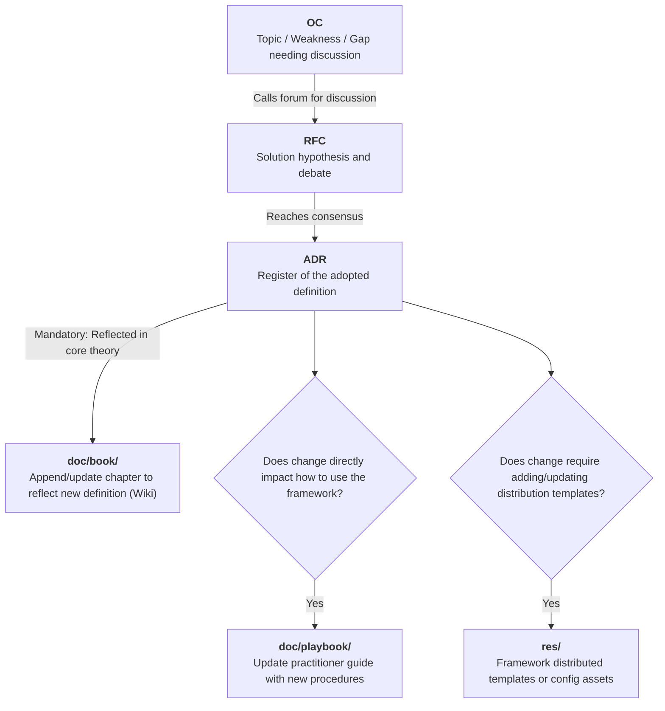
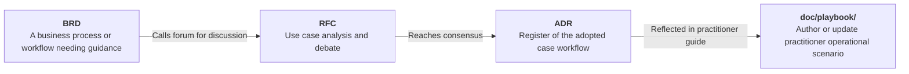
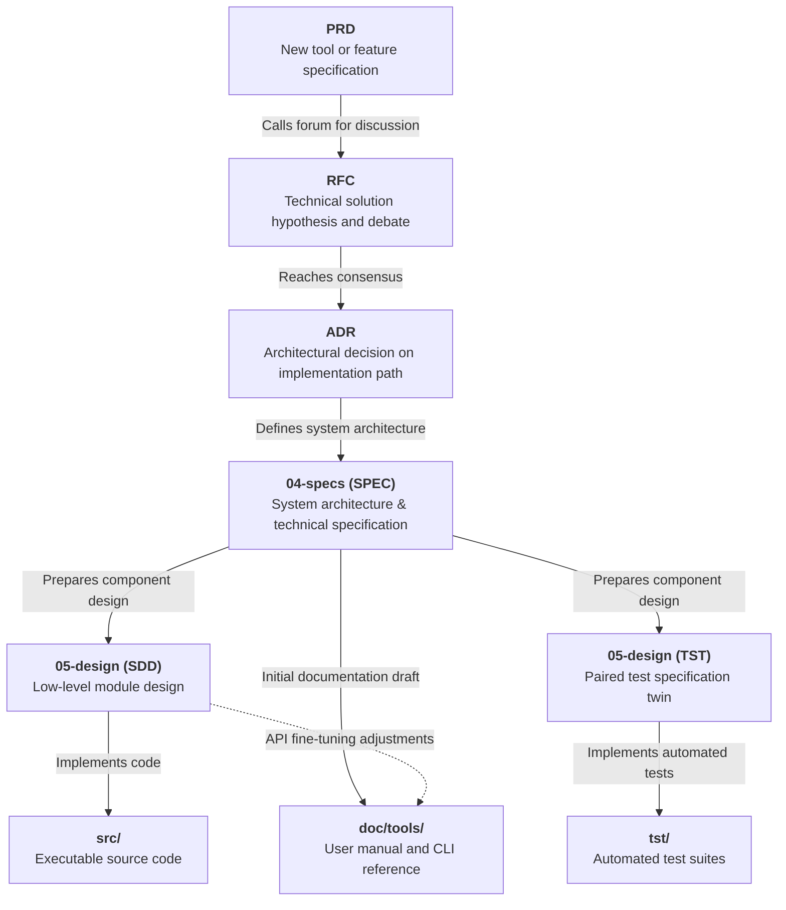
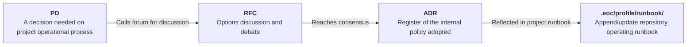

# RFC-0003: Knowledge Architecture, Documentation Taxonomy, and Distributable Assets Structure

## 1. Problem Statement
* **Technical Challenge:**
  The Engineering-as-Code (EoC) framework develops methodology rules, operational playbooks, software tooling, and distribution assets (templates and schemas). Currently, documentation placeholders in `doc/` (`guides/`, `api-reference/`, `operators-manual/`) are generic and fail to distinguish between:
  1. Deep theoretical framework methodology.
  2. Concrete practitioner adoption playbooks.
  3. Tool and CLI references.
  4. Internal project operational runbooks.
  
* **Context:**
  Derived from [PID-0003-PD-doc-structure.md](arch/01-seed/PID-0003-PD-doc-structure.md), this RFC establishes the knowledge taxonomy of the framework and formalizes the operational distinction between the local dogfooded `.eoc/` directory and the root `res/` distribution package.

---

## 2. Proposed Architecture & Taxonomy

### 2.1 The Four Documentation Pillars

The documentation space is partitioned into four distinct tiers based on audience, permanence, and operational scope:

```text
[Project root]
├── doc/
│   ├── book/             # Pillar 1: EoC Book (Theoretical methodology & Wiki source of truth)
│   ├── playbook/         # Pillar 2: EoC Playbook (Practitioner adoption & scenario guides)
│   └── tools/            # Pillar 3: EoC Tooling (User manuals, CLI syntax, and tool APIs)
│
├── .eoc/
│   └── profile/
│       └── runbook/      # Pillar 4: EoC Runbook (Internal repo governance & operations)
│
└── res/                  # Distributable Product Assets (Pristine templates, schemas, and packaging assets)
```

1. **EoC Book (`doc/book/`):**
   * **Audience:** Architects, framework creators, methodology auditors, and technical leads.
   * **Scope:** The comprehensive theoretical philosophy, governance rules, lifecycle states, frontmatter lineage specifications, and agent traversal axioms of EoC.
   * **Structure:** A modular directory containing multiple structured markdown files and subdirectories. This modular tree acts as the direct source of truth from which the public **EoC Wiki / Documentation Site** is automatically published.
   * **Lifecycle:** Directly updated or appended when an accepted `ADR` ratifies an architectural rule or conceptual change.

2. **EoC Playbook (`doc/playbook/`):**
   * **Audience:** Software engineers, project leads, Scrum masters, and AI agents applying EoC.
   * **Scope:** The practitioner's handbook. Contains actionable, step-by-step procedures: how to initialize a new project with EoC, how to write and manage test twins, how to conduct concept spikes, and how to navigate edge cases.
   * **Lifecycle:** Updated when process best practices evolve or when new operational procedures are formalized.

3. **EoC Tooling (`doc/tools/`):**
   * **Audience:** End-users, DevOps engineers, and CI/CD pipeline integrators.
   * **Scope:** Reference manuals, installation guides, command-line interfaces (CLI) syntax, and SDK references for utilities and tools distributed by the EoC framework.
   * **Lifecycle:** Generated and maintained alongside code changes in `src/`, derived from system specifications (`SPEC`) and software design documents (`SDD`).

4. **EoC Runbook (`.eoc/profile/runbook/`):**
   * **Audience:** Internal contributors and maintainers of the `eoc-framework` repository.
   * **Scope:** Repository-specific operating procedures: triage rules, severity qualification thresholds, review quorums, meeting cadences, and CI/CD policies.
   * **Distinction:** Changes to the runbook govern *how this repository operates*, without altering the universal framework definitions.

---

### 2.3 Specialized Production Scenarios within the Core Invariant Flow

The four knowledge tiers and asset targets do not create competing workflows; they represent **specialized output routes** of the single invariant macro-pipeline defined in [RFC-0001](arch/02-concept/active/RFC-0001-workflow.md):
$$\mathbf{01\text{-}seed} \longrightarrow \mathbf{02\text{-}concept} \longrightarrow \mathbf{03\text{-}decisions} \longrightarrow \mathbf{Downstream\ Execution}$$

To guarantee deterministic parsing by autonomous agents and human readers alike, each specialized scenario is modeled as an independent, unambiguous flowchart.

#### Scenario 1: EoC Framework Methodology Development
Initiated when an exploratory opportunity, gap, or weakness in framework methodology requires formal debate and definition.


#### Scenario 2: EoC Playbook Redaction
Initiated when a business process, team workflow, or practitioner adoption scenario needs formal operational guidance.


#### Scenario 3: EoC Tooling & CLI Development
Initiated when building, updating, or fixing executable tools, CLI commands, or scripts distributed with the framework.


#### Scenario 4: EoC Internal Project Decisions
Initiated when establishing or updating internal repository operating procedures, contributor guidelines, triage rules, or governance policies.


---

## 3. Evaluated Approaches & Alternatives

### Option A: Specialized Four-Tier Knowledge Architecture & Dedicated `res/` (Proposed)
* **Technical Design:** As described above. Differentiated folders for theory (`book`), application (`playbook`), tooling (`tools`), and operations (`runbook`), paired with a root `res/` directory for distributable templates.
* **Pros:**
  * Clear, uncompromised separation between theoretical framework rules and hands-on practitioner instructions.
  * Resolves dogfooding confusion: `.eoc/` is clearly our local engine, `res/` is our distributed product.
  * Provides a direct, modular source of truth for the public EoC Wiki.
  * Preserves the universal macro-pipeline while providing specialized, deterministic downstream hand-offs.
* **Cons:**
  * Requires restructuring existing placeholder folders and migrating documentation links.

### Option B: Monolithic Docs-as-Code Directory (Status Quo)
* **Technical Design:** Retain the generic `doc/guides/`, `doc/api-reference/`, and `doc/operators-manual/` placeholders, housing templates directly in `.eoc/templates/`.
* **Pros:**
  * No directory migration required.
* **Cons:**
  * Conflates framework methodology with user documentation.
  * Blurs the line between templates used by this repository and templates packaged for export.
  * Fails to provide an intuitive layout for publishing the EoC Wiki.

---

## 4. Trade-Off Analysis

| Evaluation Criteria | Option A (Four-Tier & `res/`) | Option B (Status Quo Monolith) |
| :--- | :--- | :--- |
| **Conceptual Clarity** | **High:** Explicit purpose for every document class. | **Low:** Generic and ambiguous folders. |
| **Packaging & Distribution** | **Clean:** `res/` isolates pristine distributable assets. | **Coupled:** Confuses local engine with product. |
| **Wiki Integration** | **Direct:** `doc/book/` maps 1:1 to public Wiki. | **Diffused:** Scattered across multiple guides. |
| **Internal Governance** | **Explicit:** `.eoc/profile/runbook/` houses project policy. | **Ambiguous:** Mixed into public operators-manual. |

---

## 5. Migration Strategy & Scope Boundaries

### Migration Steps (Upon ADR Ratification):
1. Create the target directories: `doc/book/`, `doc/playbook/`, `doc/tools/`, `.eoc/profile/runbook/`, and `res/`.
2. Populate `res/templates/` with the current pristine templates from `.eoc/templates/`.
3. Retire the provisional placeholders (`doc/guides/`, `doc/api-reference/`, `doc/operators-manual/`).
4. Update the repository `README.md` to link directly to the designated entry-point page under `doc/book/`.
5. Update `.eoc/taxonomy.yaml` to reflect the ratified knowledge architecture.

### Explicit Scope Boundaries & Deferred Items:
1. **Wiki Publishing Pipeline:** Automated publishing pipelines (e.g., compiling `doc/book/` into GitHub Pages, MkDocs, or Docusaurus) are out of scope for this RFC. For now, navigation is anchored via repository links and `README.md`. Automated publishing will be addressed in a future Project Decision (`PD`).
2. **Template Synchronization & Tooling Checks:** Tooling to automatically synchronize or audit differences between distribution assets in `res/templates/` and the local dogfooding engine in `.eoc/templates/` is out of scope here. This will be addressed during the EoC Tooling design phase (`PRD -> RFC`).
