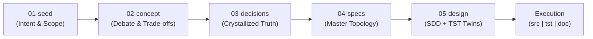
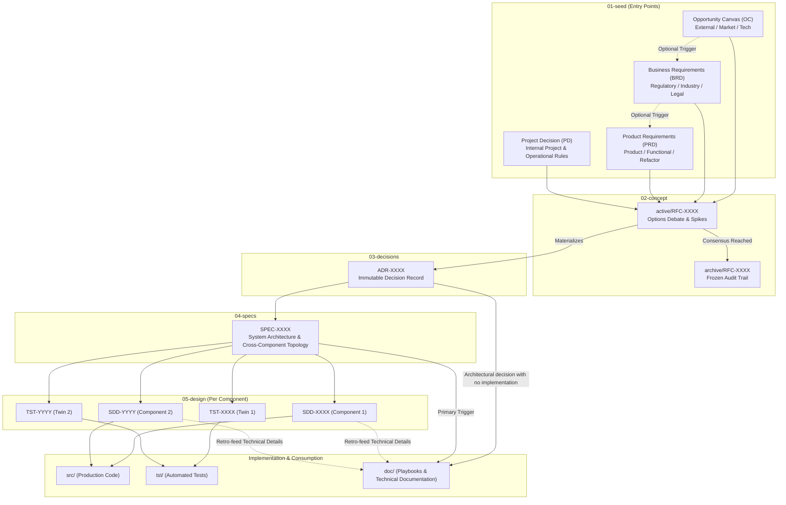
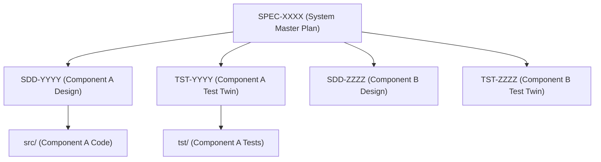

# 2.2 The Standard Journey

> "Engineering rigor is not about bureaucracy; it is about building an unbroken, machine-navigable chain of intent from initial problem to production code."

The standard development journey in Engineering-as-Code (EoC) is governed by an invariant macro-pipeline formally ratified in [ADR-0003](../../arch/03-decisions/ADR-0003-baseline-workflow.md):

$$\mathbf{01\text{-}seed} \longrightarrow \mathbf{02\text{-}concept} \longrightarrow \mathbf{03\text{-}decisions} \longrightarrow \mathbf{04\text{-}specs} \longrightarrow \mathbf{05\text{-}design} \longrightarrow \mathbf{Execution\ (src \mid tst \mid doc)}$$

## The Two Invariant Laws of the Macro-Pipeline

1. **The Invariance Law ("No Skipping"):**
   No macro-stage may ever be skipped. Production code cannot bypass a module design; a design cannot bypass a system specification; a specification cannot exist without an immutable decision; a decision cannot be made without exploratory debate; and debate cannot begin without an anchored seed. This rule prevents architectural drift and rogue code generation by both human contributors and autonomous AI agents.
2. **The Early Exit Law:**
   Initiatives are never forced to produce code. An initiative may terminate gracefully at any stage if the idea is deemed unviable, deprioritized, or concluded as an organizational policy (such as a governance ADR that alters repository workflow without altering executable binaries).

---

## Core Workflow Topology

The holistic architecture of the standard journey spans five governance tiers and the execution triad:

---

### 2.2.1 The Seeds (`arch/01-seed/`)

Every engineering journey begins with an explicit Seed artifact (a Project Initiative Document or PID). Seeds represent the formal entry points where intent, business context, and problem boundaries are captured before anyone begins architecting solutions.

#### The Seed Taxonomy
Contributors select the seed type that matches the operational trigger:
* **Opportunity Canvas (`PID-XXXX-OC`):** Triggered by market research, emerging technologies, competitive shifts, or experimental spikes. Answers: *Is this viable, what problem does it solve, and what is the potential value?*
* **Business Requirements Document (`PID-XXXX-BR`):** Triggered by commercial obligations, legal guardrails, industry standards, or regulatory compliance (e.g., GDPR, SOC2, tax legislation). Answers: *What non-negotiable business constraints must be respected?*
* **Product Requirements Document (`PID-XXXX-PR`):** Triggered by user feedback, functional requirements, feature requests, or system deprecations. Answers: *What user journeys and functional behaviors must be delivered?*
* **Project Decision (`PID-XXXX-PD`):** Triggered by the need to govern internal repository conventions, contributor workflows, CI/CD operational policies, or documentation taxonomy. Answers: *How must this repository operate?*

#### Flexible Entry & Rejection Memory
* **Flexible Entry:** An initiative does not require a rigid cascade from `OC` to `BR` to `PR`. If a product feature is already justified, work enters directly at `PID-PR`.
* **The Memory of Rejection:** When an idea is investigated and discarded, the Seed is marked `rejected` and retained permanently in the repository. This institutional memory prevents future teams from resurrecting failed or discarded concepts without fresh context.

---

### 2.2.2 The Concept (`arch/02-concept/`)

Once a Seed is accepted, technical exploration moves into the Request for Comments (`RFC-XXXX`) tier under `arch/02-concept/`.

The RFC is the arena of debate, alternative evaluation, and technical spikes:
* **Exploring the Multiverse of Solutions:** A high-quality RFC does not just present one idea; it compares competing options (e.g., Option A vs. Option B), laying out benchmark data, risk profiles, and trade-off matrices.
* **The Living Debate (`active/`):** While consensus is being forged among team members and AI agents, the RFC resides in `arch/02-concept/active/`. Open questions and technical dilemmas are actively debated and refined.
* **Preserving Historical Context (`archive/`):** Once consensus is achieved (or the RFC is rejected), the document is updated to link to the resulting decision, marked `accepted` or `rejected`, and moved to `arch/02-concept/archive/`. It is permanently frozen to preserve the vital answer to: *"Why did we choose protocol Y instead of X?"*

---

### 2.2.3 The Decision (`arch/03-decisions/`)

When consensus is reached on an RFC, the chosen path is crystallized into an Architecture Decision Record (`ADR-XXXX`) under `arch/03-decisions/`.

* **Distilled Truth:** While the RFC captures the noise, debates, and discarded hypotheses of the discussion, the ADR strips away the noise to record the clean, authoritative commitment of the architecture.
* **The Immutability Principle:** ADRs are strictly immutable and append-only. They are never modified or rewritten in-place.
* **Supersession Lineage:** If architectural directions evolve or technology choices change over time, teams author a new RFC and a new ADR that explicitly declares `supersedes: [ADR-XXXX]`. This creates a transparent, auditable trail tracking the software's structural evolution over years.

---

### 2.2.4 The Specification (`arch/04-specs/`)

An ADR ratifies *what* was decided; a Specification (`SPEC-XXXX`) under `arch/04-specs/` articulates the **master plan** for making that decision concrete across the system.

* **Holistic System Topology:** A SPEC defines cross-service boundaries, overarching data flows, communication protocols, and runtime constraints.
* **The $1:M$ Decomposition:** Architecture rarely maps 1:1 to code modules. A single strategic SPEC acts as a parent plan that coordinates changes across multiple distinct microservices, libraries, or frontend components.
* **The Primary Trigger for Documentation:** SPECs formalize the public system model, serving as the primary foundation for high-level consumption guides and architecture overviews in `doc/`.

---

### 2.2.5 The Design (`arch/05-design/`)

With the system-level topology established in a SPEC, individual component implementations are designed under `arch/05-design/` through inseparable **Component Twins**:

* **Software Design Document (`SDD-XXXX`):** Details internal algorithms, class signatures, state machine transitions, and database schemas for a single module.
* **Test Twin (`TST-XXXX`):** Born simultaneously with the SDD, defining executable verification harnesses, evaluation benchmarks, edge cases, and Behavior-Driven Development (BDD) scenarios before any code is written.
* **Guiding Human and AI Execution:** By supplying precise interface schemas and concrete acceptance tests in the SDD/TST twins, autonomous AI agents and human developers can implement source code without hallucination, guesswork, or scope creep.

---

### 2.2.6 The Execution Triad: Build, Test, Document

The final stage of the standard journey produces the concrete artifacts that ship to production. Under EoC, deliverables are not scattered, piecemeal PRs—they are merged as a synchronized atomic triad:

1. **`src/` (Production Code):** The executable implementation strictly satisfying the algorithms and schemas declared in the governing SDD.
2. **`tst/` (Automated Tests):** Executable test suites directly implementing the assertions and scenarios specified in the paired TST twin.
3. **`doc/` (Knowledge & Consumption):** User-facing documentation, CLI syntax, and operational playbooks in `doc/playbook/` and `doc/tools/` updated to reflect the new functionality.

---

### 2.2.7 Defect & Remediation Lifecycle

Even in well-governed systems, unexpected behaviors and bugs occur post-merge. Rather than handling defects through ad-hoc out-of-band patches, EoC treats defect remediation as a first-class citizen of the lifecycle, governed by an **Operational Urgency Gate**:

```mermaid
flowchart TD
    Issue["Post-Merge Defect Detected"] --> Urgency{"Operational Urgency?"}
    
    Urgency -->|"P0 / Outage / Breach<br/>(Time-critical emergency)"| EmergencyFlow["Emergency Fast-Track (ADR-0004)<br/>Incident Twins (OID-IR + OID-PM)"]
    Urgency -->|"Standard Defect<br/>(Non-life-threatening)"| Triage{"Defect Nature Triage"}
    
    Triage -->|"Functional bug / crash / regression"| PRD["PID-XXXX-PR<br/>(Product Requirements)"]
    Triage -->|"Compliance / regulatory violation"| BRD["PID-XXXX-BR<br/>(Business Requirements)"]
    Triage -->|"Performance bottleneck / latent fragility"| OC["PID-XXXX-OC<br/>(Opportunity Canvas)"]
    
    PRD --> MacroPipeline["Standard Macro-Pipeline<br/>(Lean RFC &#8594; ADR &#8594; SPEC &#8594; SDD + TST)"]
    BRD --> MacroPipeline
    OC --> MacroPipeline
```

#### 1. In-Flight Failures vs. Post-Merge Defects
* **In-Flight Validation Failures:** Automated test failures during active development or pull request CI runs are not separate issues. Contributors iterate in-place within the current task until CI passes.
* **Post-Merge Issues:** Defects discovered in merged or released code formally re-enter repository governance as a new Seed.

#### 2. The Operational Urgency Gate
* **Standard (Non-Life-Threatening) Defects:** Bugs, localized logic errors, non-blocking crashes, or performance degradation follow the standard macro-pipeline. An RFC and ADR are authored (which may be lean and targeted) to assess the risk of the fix, prevent knee-jerk patches, and avoid collateral regressions.
* **Critical / Life-Threatening Emergencies:** If a defect actively threatens system availability, security, or data integrity where minutes matter, it leaves the standard pipeline and triggers the **Operational Incident Response Lifecycle** (governed by [ADR-0004](../../arch/03-decisions/ADR-0004-incident-lifecycle.md) and detailed in [2.3 The Side Journeys](03-side-journeys.md)).

#### 3. The Test Twin Remediation Guarantee
If a bug escaped into merged code, the test harness was deficient by definition. Therefore, remediation mandates:
1. The paired Test Twin (`TST-XXXX`) and executable test suite in `tst/` must be updated **first** with a failing reproduction test.
2. Production code in `src/` is then updated to satisfy the new test assertion.

---

| [❮ Previous: 2.1 The Philosophy of Journey](01-philosophy-of-journey.md) | [Summary](../SUMMARY.md) | [Next: 2.3 The Side Journeys ❯](03-side-journeys.md) |
| :--- | :---: | ---: |
