# 2.3 The Side Journeys

> "A governance framework that cannot accommodate production emergencies will inevitably be abandoned during production emergencies."

While the standard macro-pipeline ([2.2 The Standard Journey](02-standard-journey.md)) guarantees architectural rigor during planned feature delivery and routine defect remediation, real-world software engineering regularly faces crises that require specialized, sanctioned alternative paths.

---

## The Philosophy of Sanctioned Alternative Paths

In traditional development environments, rigid governance processes often break down the moment a critical production incident occurs. When the database is down, customer data is at risk, or an active security breach is detected, engineering teams cannot afford to author a multi-day RFC, convene an architecture review board for an ADR, and formalize a system-wide SPEC before deploying a fix.

When a framework offers only a single, heavy "happy path," engineers and autonomous agents are forced into **shadow engineering**:
* Pushing hotfixes directly to production branches out-of-band.
* Bypassing automated test suites to save minutes.
* Promising to "write the documentation later"—a promise that is almost never kept.

Shadow engineering destroys the integrity of the repository's machine-navigable graph, creates untracked architectural drift, and causes vital post-incident learnings to be permanently lost.

In Engineering-as-Code (EoC), we solve this dilemma by **officially sanctioning alternative side journeys**. Rather than pretending emergencies do not exist, the framework builds dedicated, rapid-response tracks with explicit structural gates, ensuring that even under extreme operational pressure, 100% of codebase evolution remains auditable, test-driven, and permanently anchored.

---

## 2.3.1 The Incident Response Lifecycle (OID)

Formally ratified in [ADR-0004](../../arch/03-decisions/ADR-0004-incident-lifecycle.md), the primary side journey in EoC is the **Operational Incident Response Lifecycle**, governed by paired **Incident Twins (OID)** located under `arch/99-incidents/`.

### Core Lifecycle Flowchart

```mermaid
flowchart TD
    subgraph ActiveIncident["arch/99-incidents/active/"]
        IR["OID-XXXX-IR (Incident Report)<br/>Status: in-progress &#8594; contained &#8594; finished<br/>Telemetry, triage log, containment plan"]
        PM["OID-XXXX-PM (Post-Mortem)<br/>Status: draft &#8594; under-review &#8594; approved &#8594; closed<br/>Root cause, systemic failures, follow-up audit"]
    end

    subgraph HotfixExecution["Emergency Containment Fast-Track"]
        SDD["SDD-YYYY (Hotfix Design)"]
        TST["TST-YYYY (Reproduction Twin)"]
        SRC["src/ (Hotfix Patch)"]
        TST_CODE["tst/ (Passing Harness)"]
    end

    subgraph UpstreamGovernance["Long-Term Governance Loop"]
        Seed["New Seed (OC / BRD / PRD)<br/>Systemic architectural rework"]
        MacroPipeline["Standard Macro-Pipeline<br/>(RFC &#8594; ADR &#8594; SPEC &#8594; SDD + TST)"]
    end

    subgraph Archive["arch/99-incidents/archive/"]
        ClosedTwin["OID-XXXX-IR (finished)<br/>OID-XXXX-PM (closed)"]
    end

    %% Containment execution
    IR -->|"Drives Fast-Track (1:M)"| SDD & TST
    SDD --> SRC
    TST --> TST_CODE
    
    %% Post-mortem transition
    IR -.->|"Stabilized / Contained"| PM
    PM --> RootCauseCheck{"Does root cause require<br/>systemic rework?"}
    
    %% Upstream Seed Lock
    RootCauseCheck -->|"Yes"| SpawnSeed["Draft Upstream Seed<br/>(relations.derives_from: OID-XXXX-PM)"]
    SpawnSeed --> Seed
    Seed --> MacroPipeline
    SpawnSeed --> CloseIncident["Close PM & Mark IR finished"]
    
    RootCauseCheck -->|"No (Localized defect)"| CloseIncident
    
    CloseIncident --> ClosedTwin
```



---

### Core Mechanics of the Emergency Side Journey

#### 1. Separation of Concerns: The Incident Twin (`OID-XXXX`)
Emergency handling cleanly separates frantic tactical containment from calm, reflective root-cause analysis by dividing the incident into two distinct documents:
* **Incident Report (`OID-XXXX-IR-...md`):**
  * Focuses exclusively on **immediate containment and operational triage**.
  * Documents the trigger timeline, observed telemetry anomalies, blast radius, reproduction steps, and tactical mitigation strategy.
  * Authorizes the emergency fast-track, directly commissioning hotfix design and test twins.
  * Status transitions: `in-progress` $\longrightarrow$ `contained` $\longrightarrow$ `finished`.
* **Post-Mortem (`OID-XXXX-PM-...md`):**
  * Focuses exclusively on **blameless root-cause analysis and institutional learning**.
  * Initiated only after the immediate crisis is contained and systems are stabilized.
  * Analyzes underlying systemic weaknesses, procedural failures, and technical debt using structured frameworks (e.g., 5 Whys, timeline reconstruction).
  * Status transitions: `draft` $\longrightarrow$ `under-review` $\longrightarrow$ `approved` $\longrightarrow$ `closed`.

#### 2. Fast-Track Containment & Decoupled Numbering ($1:M$)
* **Bypassing the Conceptual Phase:** Under an active `OID-IR`, responders and AI agents bypass the standard `01-seed`, `02-concept`, `03-decisions`, and `04-specs` phases, jumping straight to `05-design`.
* **Decoupled Numbering:** There is no shared monotonic sequence between `OID-XXXX` and `SDD-YYYY`. An emergency incident receives its own identifier under `arch/99-incidents/`.
* **$1:M$ Cardinality:** Catastrophic outages rarely touch only one file. A single incident report (`OID-IR`) can commission multiple distinct Software Design Documents (`SDD`) and Test Twins (`TST`) across different components.
* **Deterministic Lineage:** Traceability is preserved in the hotfix frontmatter:
  ```yaml
  relations:
    derives_from: ["arch/99-incidents/active/OID-0001-IR-db-connection-exhaustion.md"]
  ```

#### 3. The Test Twin Hotfix Requirement
Speed is critical during an outage, but deploying unverified code under pressure frequently causes secondary, more catastrophic failures.

Under EoC, **emergency velocity never excuses unverified code**:
* Even during a P0 containment, no hotfix code may enter `src/` without an accompanying Test Twin (`TST-YYYY`) and executable automated test in `tst/`.
* The automated test must explicitly reproduce the defect and pass only when the containment patch in `src/` is applied.

#### 4. The Upstream Seed Lock (Anti-Amnesia Guarantee)
The greatest failure of industry post-mortems is that corrective action items are routinely forgotten once normal operations resume.

EoC eliminates post-mortem amnesia through a **hard structural governance gate**:
1. An Incident Report (`IR`) **cannot** transition to `finished` until its paired Post-Mortem (`PM`) is approved.
2. If the Post-Mortem identifies that preventing future occurrences requires systemic architectural, regulatory, or functional rework, the incident twins **cannot be closed or moved from `arch/99-incidents/active/` to `arch/99-incidents/archive/` until the draft of the new Seed (`OC`, `BR`, or `PR`) has been physically created** in `arch/01-seed/` with bidirectional metadata linking.

The incident remains visibly active in repository monitoring until the long-term architectural repair is officially initiated in the standard macro-pipeline.

---

### Framework Mechanism vs. Project Runbook Policy

To maintain flexibility across diverse engineering domains, EoC draws a sharp boundary between framework mechanisms and project policies:
* **The Framework Layer:** Standardizes artifact schemas, folder hierarchies (`arch/99-incidents/active|archive/`), lifecycle state machines, and the Upstream Seed Lock.
* **The Project Runbook Layer:** Individual engineering organizations configure operational parameters in their repository runbook (`.eoc/profile/runbook/`), including:
  * **Qualification Matrix:** The severity thresholds (e.g., P0/P1, data loss, security CVE) that authorize bypassing the standard journey.
  * **Authority Quorums:** The roles or agent permissions authorized to declare an incident and approve emergency merges.
  * **Resolution SLAs:** Mandatory timelines for containment, post-mortem publication, and upstream seed drafting (e.g., PM approval within 48 to 72 hours of containment).

---

| [❮ Previous: 2.2 The Standard Journey](02-standard-journey.md) | [Summary](../SUMMARY.md) | [Next: 3.1 Agent-First Philosophy ❯](../03-ai-tooling/01-agent-first-philosophy.md) |
| :--- | :---: | ---: |
